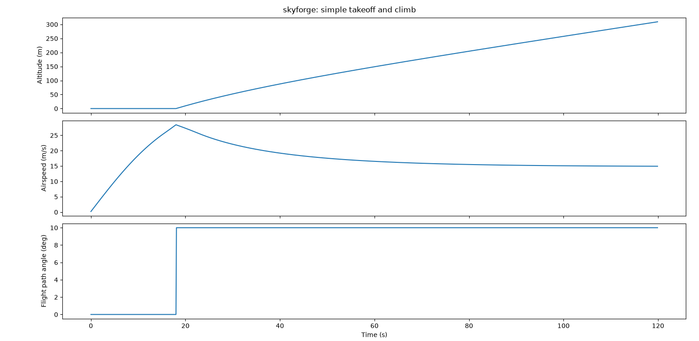
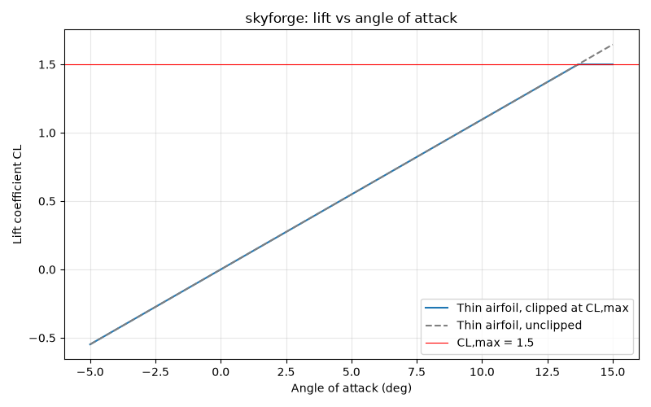

# skyforge



A small flight dynamics sandbox. Define an aircraft's mass, wing area, thrust, and drag coefficients, then simulate its takeoff, climb, and cruise and plot the results.

## Features
## Features
- `aircraft.py`: shared aircraft parameters used by all scripts
- `simulate.py`: simulates takeoff and climb, and reports takeoff distance
- `glide.py`: calculates best glide ratio, best glide speed, and glide distance
- `wing_size.py`: computes the wing area needed for a target takeoff speed
- `compare.py`: compares stall speeds for a few aircraft
- `lift_alpha.py`: plots lift coefficient vs angle of attack using thin airfoil theory, clipped at CL,max
- `drag_polar.py`: plots the drag polar (CD vs CL) and marks the best glide point
- `unit_cost.py`: estimates cost per flight hour, break-even price, and profit for a 4-seat charter (uses placeholder costs)
## Limitations
- Climb angle is fixed at 10° after liftoff rather than computed from the forces.
- Thrust is constant and air density follows a simple exponential model.
- Results are rough estimates for learning, not for real aircraft design.
## Setup
```bash
pip install numpy matplotlib
python simulate.py
```

## Roadmap
- Glide ratio calculator
- Wing sizing from lift requirements
- Comparison of real aircraft specs
