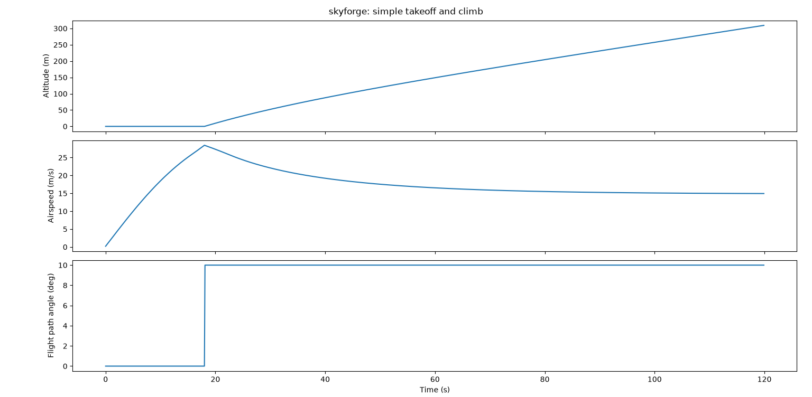

# skyforge

A small flight dynamics sandbox. Define an aircraft's mass, wing area, thrust, and drag coefficients, then simulate its takeoff, climb, and cruise and plot the results.

## Features
- Simple point-mass aircraft model
- Lift and drag from standard aerodynamic equations
- Plots of altitude, airspeed, and angle of attack over time
- `glide.py`: calculates best glide ratio, best glide speed, and glide distance
- `wing_size.py`: computes the wing area needed for a target takeoff speed

## Setup
```bash
pip install numpy matplotlib
python simulate.py
```

## Roadmap
- Glide ratio calculator
- Wing sizing from lift requirements
- Comparison of real aircraft specs
